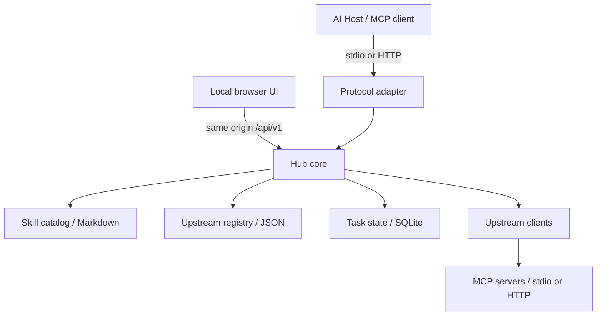

# 구성요소와 상태

문서 ID: ARCH-COMPONENTS · 요구사항: REQ-SKILL, REQ-REGISTRY, REQ-CALL, REQ-UI

| 경계 | 책임 | 상태 원천 |
|---|---|---|
| 스킬 catalog | name/description 검색, 본문·참조 안전 조회 | `skills/` Markdown |
| registry | 등록·검증·설정 저장, 활성 상태 | state directory JSON |
| protocol adapter | 버전별 wire 의미를 내부 호출로 변환 | 요청별 metadata 또는 연결 문맥 |
| upstream client | 발견·호출·리소스 전달·timeout | upstream 응답, 연결별 프로세스 |
| tasks | 상태·결과·취소와 수명 | state directory SQLite |
| HTTP UI/API | 상태 표현, 입력 검증, 로컬 접근 제한 | core에서 조회, 별도 복제 없음 |
| installer | agent 감지·관리 파일·등록 보존 | 설치 manifest와 파일 hash |

## 검색·실행 흐름

검색은 스킬 설명과 발견한 도구의 설명을 대상으로 한다. 상세 schema와 스킬 본문은
선택 후 가져온다. 호출 대상은 upstream ID와 도구 이름으로 구별하여 이름 충돌을 막는다.
연결된 도구는 native `tools/list`에서도 원래 schema와 함께 제공한다.
검색은 선택 가능한 탐색 경로이며 Apps·Tasks metadata를 감추는 유일한 진입점으로 쓰지 않는다.
upstream 실패가 다른 upstream과 로컬 스킬 조회를 중단시키지 않도록 시간을 제한한다.

MCP payload 안의 URI·도구명·task ID가 다른 upstream과 충돌하지 않도록 매핑한다.
본문 안의 임의 문자열까지 찾아 바꾸면 의미가 변할 수 있으므로 계약 필드만 처리한다.
목록 발견은 등록된 서버에 실제로 접속할 수 있으며, stdio 서버는 등록한 명령을 실행한다.

## 로컬 프로세스 모델

UI와 JSON API는 같은 origin에서 제공한다. Hub는 loopback 단일 사용자 서비스다.
HTTP 서비스는 state directory의 endpoint.json에 로컬 접점을 기록한다.
기본 stdio는 독립 실행한다. 혼합 모드를 선택한 새 stdio는 같은 저장소의 HTTP Hub가 있으면
bridge로 연결해 상태와 작업을 공유한다. 직접 HTTP 모드도 제공한다.
[연결 방식과 실행 관리](../operations/06-connection-modes.md)를 본다.
혼합 모드에서 대체 실행을 선택한 경우 HTTP Hub가 없으면 standalone으로 실행한다.
이미 실행 중인 프로세스는 자동 이동하지 않는다.
작업 실행 PID가 살아 있는 동안 다른 프로세스 초기화로 실패 처리하지 않는다.
독립 프로세스의 registry 동시 수정은 단일 daemon에 모으는 운영을 권장한다.
원격 공개나 다중 사용자로 확장하기 전에 인증·권한·동시성·보관 모델을 다시 설계한다.
